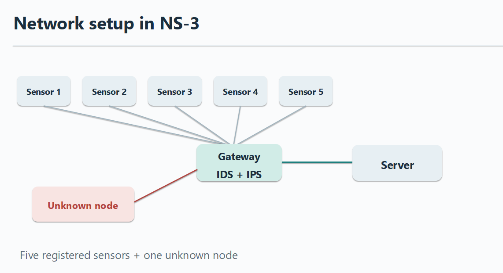
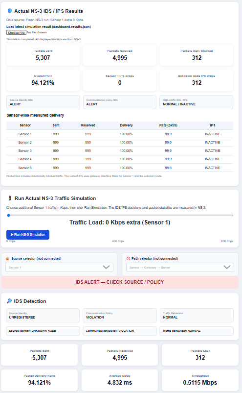
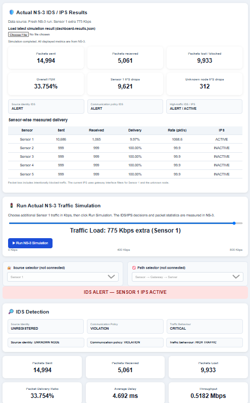
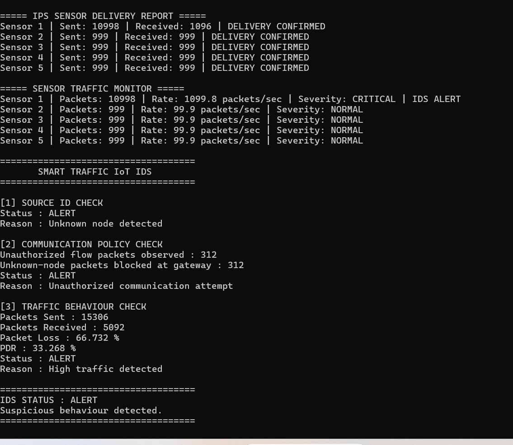
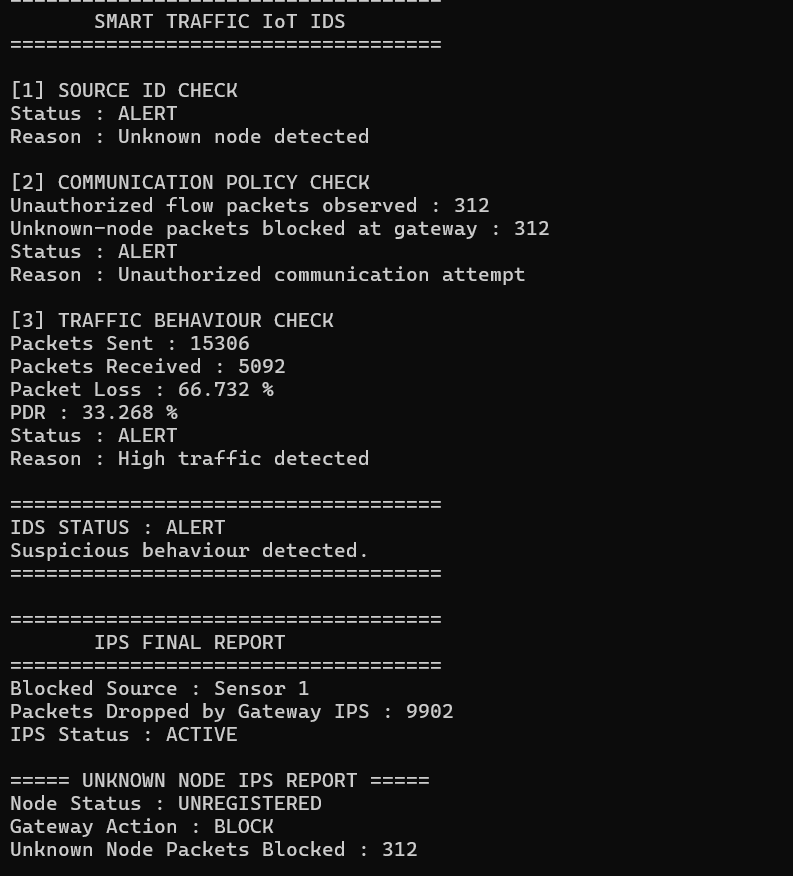

# Smart Traffic IoT Network with IDS and IPS Using NS-3

## Project Overview

This project simulates a Smart Traffic IoT network using the NS-3 network simulator and implements rule-based Intrusion Detection (IDS) and Intrusion Prevention (IPS).

The project was developed in three stages: anomaly detection, intrusion detection, and intrusion prevention.

The main objective is to identify unauthorized or excessive network traffic and prevent unwanted packets from reaching the destination server.

## Network Architecture

The simulated network consists of:

- 5 registered IoT sensor nodes
- 1 gateway with IDS/IPS functionality
- 1 central server
- 1 unknown node for unauthorized traffic testing

**Communication:** Sensors → Gateway → Server

## Key Features

- IoT network simulation using NS-3 and C++
- UDP traffic generation and IPv4 routing
- IP-based identification of registered and unknown nodes
- Rule-based traffic monitoring and intrusion detection
- Gateway-level packet blocking using NS-3 RateErrorModel
- Adjustable additional traffic for Sensor 1
- Network performance analysis using FlowMonitor
- Interactive HTML/JavaScript dashboard connected to NS-3 through a Python backend
- Automatic JSON-based transfer of simulation results to the dashboard

## Technologies Used

- **NS-3:** Network simulation
- **C++:** Network configuration and IDS/IPS logic
- **Python:** Backend integration
- **HTML, CSS, JavaScript:** Interactive dashboard
- **Ubuntu WSL:** Simulation environment
- **JSON:** Simulation result exchange

## Experimental Results

| Parameter | Normal (0 Kbps Extra) | High Traffic (800 Kbps Extra) |
|---|---:|---:|
| Total Packets Sent | 5,307 | 15,306 |
| Total Packets Received | 4,995 | 5,092 |
| Packet Delivery Ratio | 94.121% | 33.268% |
| Sensor 1 Packets Blocked | 0 | 9,902 |
| Unknown Node Packets Blocked | 312 | 312 |
| High-Traffic IPS | Inactive | Active |

In the high-traffic scenario, the IPS blocked 9,902 packets from Sensor 1, while Sensors 2–5 maintained 100% packet delivery.

The overall PDR includes intentionally blocked traffic, including packets from the unknown node.

## Project Files

- `smart-traffic-ips-live.cc` — NS-3 simulation and IDS/IPS implementation
- `ns3_dashboard_server.py` — Python backend for running NS-3
- `Smart_Traffic_IDS_IPS_Live.html` — Interactive monitoring dashboard

## How to Run

1. Install and configure NS-3 in Ubuntu.
2. Copy `smart-traffic-ips-live.cc` into the NS-3 `scratch` directory.
3. Run the simulation using:

```bash
./ns3 run "smart-traffic-ips-live --extraRateKbps=800"
```

4. Configure the Python backend paths for your local NS-3 installation.
5. Start the Python dashboard server:

```bash
python3 ns3_dashboard_server.py
```

6. Open the dashboard in your browser:

```text
http://localhost:8765/Smart_Traffic_IDS_IPS_Live.html
```

7. Adjust the traffic slider and run simulations to observe IDS/IPS results.

## Future Improvements

- Dynamic registration and authentication of IoT devices
- Independently configurable traffic for all sensor nodes
- More advanced packet-level security policies
- Machine-learning-based intrusion detection
- Integration with physical IoT hardware

## Conclusion

This project demonstrates how a simulated IoT network can be extended from basic traffic monitoring to intrusion detection and gateway-level intrusion prevention.

It also integrates NS-3 with an interactive dashboard for visualizing network performance and security decisions.

**Project Type:** Academic Network Simulation and Cybersecurity Project

## Project Screenshots

### Network Architecture


### Normal Traffic Dashboard — 0 Kbps Extra


### High-Traffic Dashboard — 775 Kbps Extra


### IDS Detection Results


### IPS Final Results

  
